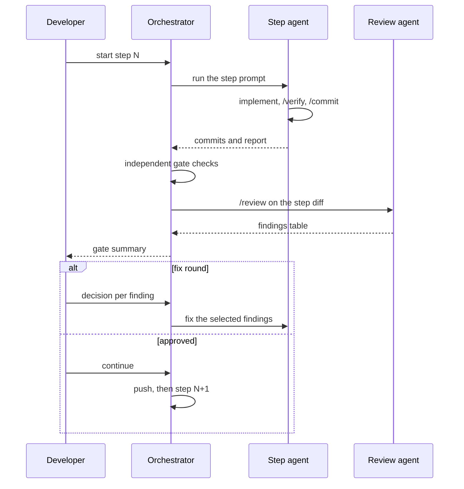

# AI-assisted development

This page answers the assignment's "AI-Assisted Development" section, one heading per bullet.
Every file named here is in the repository.

## Tools and setup

- **Claude Code** 2.1.287, run in the terminal at the repository root, for every step.
- **Models**, as the developer states them: "Fable 5.1 for design; Opus 5.5 for coding implementation".
  The design session ran with Fable 5.1 in the Claude app; the orchestrator, the step agents and the review agents of steps 1 to 8 ran with Opus 5.5 in Claude Code; the final review and its fixes (step 9) ran with Fable 5.1 in Claude Code.
- **Repository harness**, loaded by Claude Code from the repository itself:

| file | role |
|---|---|
| [`CLAUDE.md`](../CLAUDE.md) | Entry point Claude Code loads; it imports `AGENTS.md`. |
| [`AGENTS.md`](../AGENTS.md) | Hard constraints, architecture map, workflow, definition of done. |
| [`.claude/rules/`](../.claude/rules/) | Architecture, Java style, Spring, testing and commit rules, loaded automatically. |
| [`.claude/skills/`](../.claude/skills/) | `/verify`, `/commit`, `/review`, `/extend`. |
| [`.claude/settings.json`](../.claude/settings.json) | Allowed and denied commands (no force-push, amend, rebase or hard reset); registers the hook. |
| [`.claude/hooks/protect-files.sh`](../.claude/hooks/protect-files.sh) | Blocks edits to the files in [`.claude/protected-files.txt`](../.claude/protected-files.txt). |
| [`.githooks/`](../.githooks/) | `commit-msg` enforces the one-line commit convention; `pre-commit` checks formatting of staged Java files. |
| [`scripts/guardrails.sh`](../scripts/guardrails.sh) | Protected-file hashes, commit messages, exactly two operations, no hand-written mappings, banned patterns, no embedded database, assumption references. |
| [`.github/workflows/ci.yml`](../.github/workflows/ci.yml) | Runs the same checks on every push: build and tests, contract lint, sanitation, guard rails, mutation. |

## Workflow

Each step started from a written prompt.
A fresh Claude Code agent ran the prompt at the repository root, committed after a green `/verify`, and wrote a report.
The orchestrator, a separate agent, then re-ran every check itself instead of trusting the report and, for every first round and some fix rounds, started a fresh review agent with no access to the step agent's context.
The developer read the gate summary and the diff, decided on each finding, and either sent the step back for a fix round or approved it.
The branch was pushed after the developer's approval, given per step or in advance for a fix round; in step 7 the step agent pushed itself, because CI had to run.
Step 0, the harness itself, ran before the orchestrator existed and was approved commit by commit.
[`docs/ai/WORKFLOW-LOG.md`](ai/WORKFLOW-LOG.md) lists every step's commits, gate outcome and fix rounds.

## Reproducibility

1. Clone the repository and run `scripts/setup-hooks.sh` once to enable the git hooks.
2. Install JDK 17, Docker (for the Testcontainers tests and Compose) and Node.js 18 or later (for the contract lint; CI runs it on 22).
3. Open Claude Code at the repository root. It loads `CLAUDE.md`, which imports `AGENTS.md`, and the rules in `.claude/rules/`; the hook and command permissions come from `.claude/settings.json`.
4. Run `/verify` to check the tree, and `/extend` to add a requirement through its design gate.
5. To replay the build step by step, copy the files in [`docs/ai/prompts/`](ai/prompts/README.md) to `prompts/` (git-ignored), then give the prompts to fresh agents in order, under the orchestrator prompt. An optional extra pattern file can be passed to the guard rails with `GUARDRAILS_EXTRA_PATTERNS`; without it, that check is skipped.

## Custom rules, prompts and configuration

- Agent instructions: [`AGENTS.md`](../AGENTS.md), imported by [`CLAUDE.md`](../CLAUDE.md).
- Rules: [`architecture.md`](../.claude/rules/architecture.md), [`java-style.md`](../.claude/rules/java-style.md), [`spring.md`](../.claude/rules/spring.md), [`testing.md`](../.claude/rules/testing.md), [`git.md`](../.claude/rules/git.md).
- Skills: [`/verify`](../.claude/skills/verify/SKILL.md), [`/commit`](../.claude/skills/commit/SKILL.md), [`/review`](../.claude/skills/review/SKILL.md), [`/extend`](../.claude/skills/extend/SKILL.md).
- Hook and settings: [`protect-files.sh`](../.claude/hooks/protect-files.sh), [`protected-files.txt`](../.claude/protected-files.txt), [`settings.json`](../.claude/settings.json).
- Guard rails: [`guardrails.sh`](../scripts/guardrails.sh), [`banned-patterns.txt`](../scripts/banned-patterns.txt), [`protected-files.sha256`](../scripts/protected-files.sha256), [`guardrails-exclude.txt`](../scripts/guardrails-exclude.txt).
- Git hooks: [`commit-msg`](../.githooks/commit-msg), [`pre-commit`](../.githooks/pre-commit).
- Build checks: [`java/pom.xml`](../java/pom.xml) (Spotless, JaCoCo, Pitest and sanitation profiles), [`java/rewrite.yml`](../java/rewrite.yml), [`.spectral.yaml`](../.spectral.yaml).
- Prompts: [`docs/ai/prompts/`](ai/prompts/README.md), the orchestrator's and one per step.

## What was AI-assisted and why

In the developer's words: "Design decisions, requirement readings and every diff review are mine; code and tests were generated by agents under reviewed prompts and automated guard rails."
All production code, tests, migrations, the contract, the Dockerfile, the CI workflow and this documentation were generated by agents from the prompts and then reviewed.

| area | by | why |
|---|---|---|
| Design: hexagonal layout, plan catalogue, locking, contract shape | developer | Decisions with trade-offs that the rest depends on. |
| Requirement readings in [`ASSUMPTIONS.md`](ASSUMPTIONS.md) | developer | Each one interprets the assignment and needs to be owned by a person. |
| Prompt content decisions and every approval | developer | The gates decide what reaches `main`. |
| Production code, migrations, seed data, OpenAPI contract | agents, reviewed by the developer | Speed and boilerplate; the rules, ArchUnit and the guard rails constrain the output. |
| Tests: characterization, unit, integration, architecture | agents, reviewed by the developer | Breadth of the test matrix: 140 characterization cases and literal expectations from the original. |
| Dockerfile, Compose, CI workflow | agents, reviewed by the developer | Boilerplate checked by running it: Compose at the step 6 gates, CI on every push. |
| Harness: rules, skills, hook, guard rails | agents from the developer's prompt, reviewed by the developer | The prompt fixed what each rule says; the agent wrote and tested the scripts. |
| This documentation | agents, reviewed by the developer | Condensed from the step reports and the gate log. |

## What the harness caught

- **Formatter and JDK (step 0).** The first build pinned google-java-format 1.37.0, which needs Java 21; Spotless on JDK 17 allows at most 1.28.0. The build looked green only because every existing file was still excluded from formatting. Fixed forward in `a287313`.
- **A sanitation recipe that changed results (steps 0 and 1).** The composite static-analysis recipe would have rewritten `new BigDecimal(interest)` to `BigDecimal.valueOf(interest)`. In step 0 the recipe set became an explicit list without it (`da446f8`). The step 1 search then confirmed that the rewrite would have changed cents (`basic` at `18.00`: `18.01` in the original, `18.02` after the rewrite).
- **Checks that passed without checking (step 0).** The documented `-Drewrite.failOnDryRunResults=true` flag was a no-op, so a dry run with findings ended in BUILD SUCCESS; the profile now sets the option. A misspelled recipe name was also skipped silently; the run now fails on it (`a067a05`).
- **Demo pages behind the documentation (step 5).** The review agent found that the Swagger UI webjar also served its own demo page, an extra HTTP surface against A1. The build now bundles only the three assets the page needs, and a test expects `404` on the demo paths (`83b73ff`).
- **A guard rail that would fail every pull request (step 7).** The review agent found that the commit-message check also read GitHub's generated merge commits. It now skips merge commits (`3633a85`), and CI checks out the pull request head (`5fa475d`).

## Limits

- The protected-files hook detects shell writes by pattern, such as a redirect, `sed -i`, `tee`, `rm`, `mv`, `cp`, `truncate`, `git mv`, `git rm` or `perl -i` next to a protected path. It fired several times on commands that only mentioned a protected path while writing another file; the agent then used the Edit or Write tool. A write that never names the path is not detected; the hashes in `scripts/guardrails.sh` catch the change afterwards.
- Banned patterns and the extra pattern scan are regular expressions over source text; they do not understand code.
- The sanitation run cannot see members generated by Lombok; an unused generated constructor was found by review, not by a tool (step 4).
- Mutation testing covers the domain and application code; adapters and configuration are covered by integration tests only.
- Design gates, the choice between options, and reading every diff still need a person. The review agents found problems the checks could not, but the decision on each finding was the developer's.
