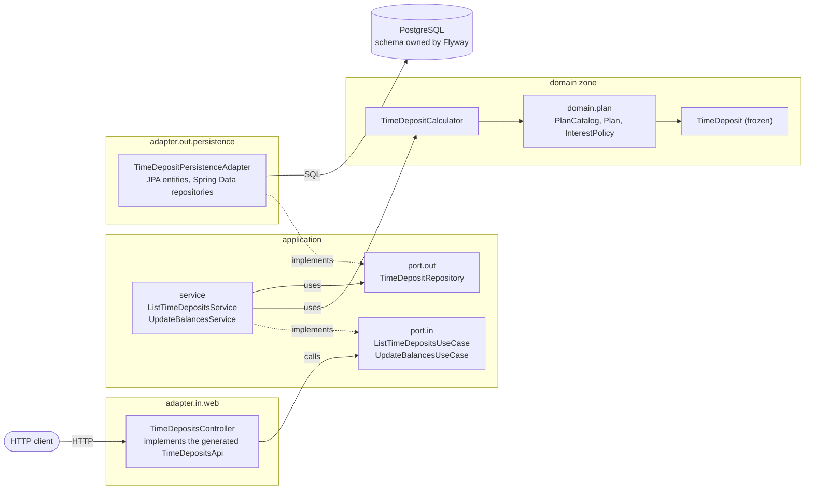

# Architecture

## Purpose

The service stores XA Bank time deposits in PostgreSQL and exposes two endpoints: one lists all deposits, the other credits one month of interest to every deposit.
It is a hexagonal refactoring of the original `TimeDepositCalculator`, whose public API and results are unchanged.

## The hexagon

Every arrow points in the direction of the source-code dependency.
Adapters depend on the application, the application depends on the domain zone, and the domain zone depends on nothing outside itself.
`config` (not drawn) creates the use cases and the calculator as beans and is the only package that may depend on everything.

## Packages and the dependency rule

| package | content |
|---|---|
| `org.ikigaidigital` | `TimeDeposit` (frozen), `TimeDepositCalculator` (same public API), Spring Boot application class |
| `org.ikigaidigital.domain` | `Withdrawal`, read models, `plan/` (interest policy, rate, earning period, plan catalogue) |
| `org.ikigaidigital.application.port.in` | use-case interfaces |
| `org.ikigaidigital.application.port.out` | `TimeDepositRepository` |
| `org.ikigaidigital.application.service` | use-case implementations; framework-free except `@Transactional` (ASSUMPTION A2) |
| `org.ikigaidigital.adapter.in.web` | controller implementing the generated API interface, DTO mappers |
| `org.ikigaidigital.adapter.out.persistence` | JPA entities, Spring Data repositories, persistence adapter |
| `org.ikigaidigital.config` | `@Configuration` wiring: use cases, calculator |

Dependency rule: `adapter.*` → `application` → `domain`; `config` → everything; nothing → `config` or `adapter.*`.
The domain zone is `org.ikigaidigital.domain..` plus `TimeDeposit` and `TimeDepositCalculator`; it imports only the JDK.
The application layer imports the JDK, the domain zone and `org.springframework.transaction..` only.

[`ArchitectureTest`](../java/src/test/java/org/ikigaidigital/ArchitectureTest.java) enforces these rules with ArchUnit, one rule per test, including "no package cycles" and "every use-case method is `@Transactional`".
The full rules are in [`.claude/rules/architecture.md`](../.claude/rules/architecture.md).

Lombok appears only in `adapter.*` and `config`, for boilerplate a reader would skip (`@RequiredArgsConstructor`, `@Getter`, JPA's protected no-arg constructor).
The domain zone and the application layer are plain records and classes, so that they stay free of any framework and of generated members the static analysis cannot see.

## Request flows

### `GET /api/v1/time-deposits`

1. The generated `TimeDepositsApi` maps the request to `TimeDepositsController.listTimeDeposits`, which calls `ListTimeDepositsUseCase`.
2. `ListTimeDepositsService` opens a read-only transaction.
3. The persistence adapter runs two queries, deposits ordered by `id` and withdrawals ordered by deposit and `id`, and groups the withdrawals under their deposit in memory (ASSUMPTION A9).
4. The transaction ends; no row is locked.
5. `TimeDepositResponseMapper` turns each `TimeDepositDetails` into the generated response model, and the controller answers `200` with the JSON array.

### `POST /api/v1/time-deposits/update-balances`

1. `TimeDepositsController.updateBalances` calls `UpdateBalancesUseCase`; `UpdateBalancesService` opens a read-write transaction.
2. The adapter loads all deposits ordered by `id` with a row lock (`PESSIMISTIC_WRITE`); the rows stay locked until the transaction ends (ASSUMPTION A10).
3. `TimeDepositCalculator.updateBalance` credits one month of interest to each deposit, as the original did (ASSUMPTION A7).
4. The adapter changes only the balance of each deposit (Hibernate's `UPDATE` statement sets every mapped column, the others with their unchanged values), then reads all deposits with their withdrawals in the same transaction.
5. The transaction commits, which releases the locks, and the controller answers `200` with the updated deposits (ASSUMPTION A8).

## Domain model

### Why `TimeDeposit` and `TimeDepositCalculator` stay where they are

The assignment forbids breaking changes to the shared `TimeDeposit` class and to the `updateBalance` signature.
Moving either class to another package would break every caller's imports, so both stay in `org.ikigaidigital`.
`TimeDeposit.java` is byte-for-byte the original; the guard rails check its hash.
`TimeDepositCalculator` keeps its public no-arg constructor and `updateBalance(List<TimeDeposit>)`; a second constructor accepts a `PlanCatalog`.
The characterization tests pin its results for every plan, age and rounding edge found in the original.

### The plan catalogue

- `PlanType` is an enum of the stored codes (`basic`, `student`, `premium`); a code is matched exactly (ASSUMPTION A6).
- `Plan` is a record of a `PlanType` and an `InterestPolicy`.
- `FixedRateInterest` is the one `InterestPolicy`: an `AnnualRate` applied inside an `EarningPeriod`, nothing outside it.
- `PlanCatalog.standard()` holds the three plans of the assignment. Each plan's first earning day is part of its period, so there is no global thirty-day guard (ASSUMPTION A5).
- The calculator looks up the plan for each deposit's code, asks its policy for the month's interest, and earns nothing for a code without a plan.

The calculator contains no plan names, rates or day counts.

### Adding a plan

These files change, and no others:

1. [`PlanType.java`](../java/src/main/java/org/ikigaidigital/domain/plan/PlanType.java): a new constant with its code.
2. [`PlanCatalog.java`](../java/src/main/java/org/ikigaidigital/domain/plan/PlanCatalog.java): a new entry in `standard()` with its rate and earning period.
3. A new migration in [`db/migration/`](../java/src/main/resources/db/migration/) that drops the `plan_type` CHECK constraint and adds one that admits the new code (ASSUMPTION A12). V1 declares the constraint inline without a name, so PostgreSQL generated the name `time_deposits_plan_type_check`.
4. [`openapi.yaml`](../java/src/main/resources/openapi/openapi.yaml): the code added to the `planType` enum; the generated model follows. `PlanTypeContractTest` fails until the enum lists the new code.
5. Tests: `PlanTypeTest` and `PlanCatalogTest` for the new constant and entry, a new calculator test class with literal expectations (the characterization tests are frozen), a persistence test that the constraint accepts the code, and `PlanTypeContractTest` passing again.

Apart from documentation (a row in `docs/ASSUMPTIONS.md` when the new plan's rule needs a reading), nothing else changes: the controller, the mappers, the converter, the use cases and the calculator stay as they are.

### Adding a rule family

A rule that is not an interest rule would get its own interface and a second field on `Plan`, next to `interest`.
The calculator or the use case that needs the rule would read that field.
No such field exists today, on purpose: without a requirement that reads it, it would be speculative code.

## Money

- `TimeDeposit.balance` is a `Double` in the frozen class, and the calculator keeps the original arithmetic in `double`: `balance * rate / 12`, in that operand order.
- The interest is rounded to cents with `new BigDecimal(interest).setScale(2, HALF_UP)`, as in the original.
  `new BigDecimal(double)` rounds the exact binary value, while `BigDecimal.valueOf` would round the shortest decimal form.
  The characterization search found balances where the two differ by a cent: for `basic` at `18.00`, the interest `0.015` is `0.01499999…` in binary, so the original credits `0.01`, not `0.02`.
  Switching would change results the assignment calls correct, so the constructor stays, with a comment on why.
- The database stores `balance` and `amount` as `NUMERIC(19,2)` (ASSUMPTION A13).
- At both boundaries, the persistence adapter and the response mapper, the `Double` balance becomes `BigDecimal.valueOf(balance).setScale(2, HALF_UP)`.
  `BigDecimal.valueOf` reads the shortest decimal form, which is the cents the calculator produced; `new BigDecimal(double)` would expose binary noise such as `10008.330000000002`.
  Loading converts back with `doubleValue()`.
- The contract types money as `type: number` with no format, so the generated models use `BigDecimal` and no `double` reaches the JSON (ASSUMPTION A16).
- `Withdrawal.amount` is a `BigDecimal` from the database to the JSON and never passes through `double`.

## Concurrency and idempotency

- The update runs in one transaction: lock all deposits, calculate, save, read back.
- The pessimistic lock serialises concurrent updates, so none is lost and none is applied twice.
  `TimeDepositsApiIT` sends five concurrent `POST`s and expects the balances of five sequential updates; removing `@Lock` from `TimeDepositJpaRepository.findAllForUpdate` makes this test fail.
- `POST` is not idempotent: every call credits one more month (ASSUMPTION A8, A17).
- Not built: running the update on a monthly schedule safely.
  That would need a record of which month each deposit was last credited for, so that a retried or doubled run credits nothing.
  The assignment's schema has no field for it, and `updateBalance` has no notion of time (ASSUMPTION A10).

## Deliberately out of scope

| topic | why | first step if needed |
|---|---|---|
| Authentication | The assignment names no users, roles or security (ASSUMPTION A19). | Validate a bearer token at the gateway, or with Spring Security as an OAuth2 resource server, and declare the scheme in the contract. |
| Input validation and error responses | "Handling invalid input or exceptions is not required." The database constraints still guard the stored data (ASSUMPTION A14). | Describe the error responses in the contract, then map exceptions to them in one place. |
| Pagination | The GET endpoint returns "a list of all time deposits". | Add page parameters to the contract and a paged query to the repository port. |
| Actuator and health | The solution must have exactly two endpoints (ASSUMPTION A1). | Enable Spring Boot Actuator on a separate management port, outside the API. |
| Metrics | No requirement, and the same two-endpoint limit. | Add Micrometer through Actuator on the management port. |

## Verification tooling

| tool | what it checks | command |
|---|---|---|
| Characterization tests (frozen) | The original calculator's results: 140 cases and its public API; their files are protected by hash. | `cd java && ./mvnw test -Dtest='TimeDepositCalculatorTest,TimeDepositCalculatorPublicApiTest'` |
| ArchUnit | Layer dependencies, no cycles, transactional use cases. | `cd java && ./mvnw test -Dtest=ArchitectureTest` |
| Testcontainers | Persistence and endpoint integration tests (`*IT`) against a real `postgres:17-alpine`. | `cd java && ./mvnw verify` |
| Pitest | 100 % mutation score and line coverage of the domain and application code: those classes are the kata's logic, a surviving mutant there is a missing test, and the thresholds are never lowered. | `cd java && ./mvnw -Pmutation test-compile org.pitest:pitest-maven:mutationCoverage` |
| OpenRewrite | Dead code and static analysis findings; any finding fails. Recipes in [`java/rewrite.yml`](../java/rewrite.yml). | `cd java && ./mvnw -Psanitize rewrite:dryRun` |
| Spotless | google-java-format formatting. | `cd java && ./mvnw spotless:check` |
| Spectral | The contract against `spectral:oas` and the rules in [`.spectral.yaml`](../.spectral.yaml); warnings fail. | `npx -y @stoplight/spectral-cli@6 lint --fail-severity=warn java/src/main/resources/openapi/openapi.yaml` |
| Guard rails | Protected-file hashes, commit messages, exactly two operations (counted again, exactly, by `GeneratedApiInterfacesTest` from the generated interfaces), no hand-written mappings, banned patterns, no embedded database, assumption references. | `scripts/guardrails.sh` |
